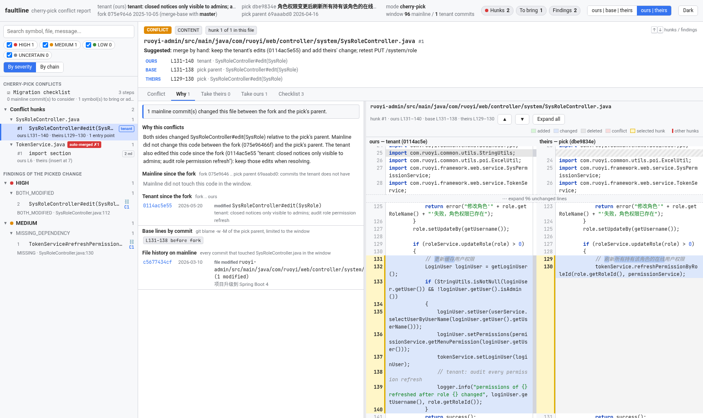
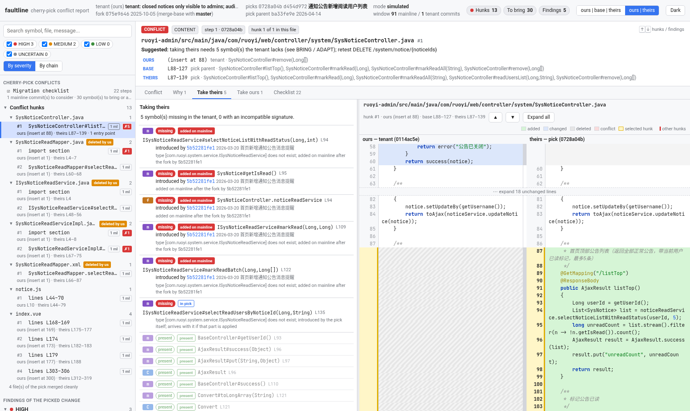
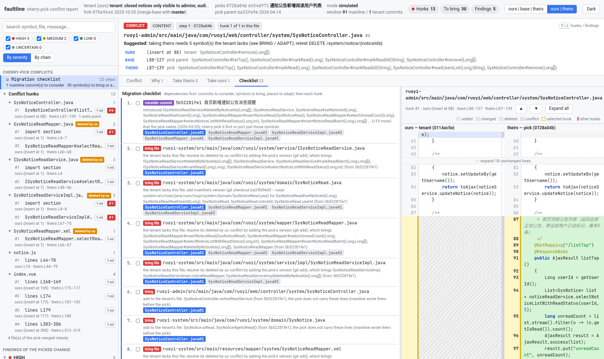
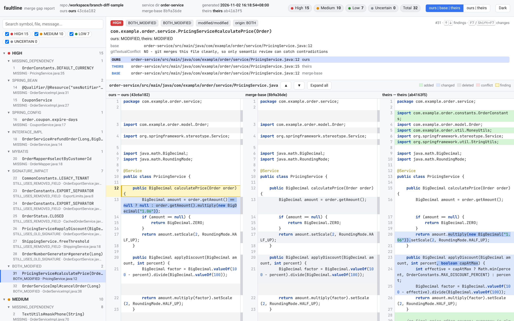
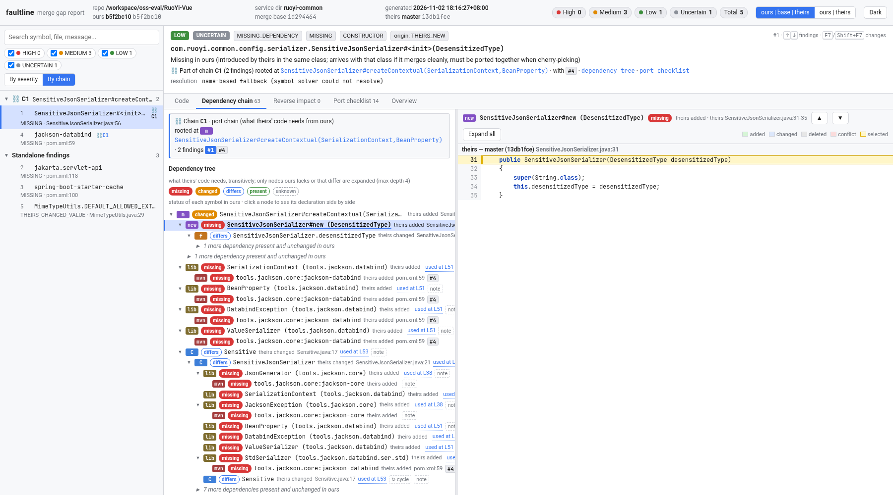

English | [简体中文](README.zh-CN.md)

# faultline

**Explain cherry-pick conflicts when a tenant branch is months behind mainline.**

A tenant codebase forked from mainline long ago. You cherry-pick one feature from mainline, one commit or a few. Git stops on conflicts. The conflicting code is usually code that mainline added, refactored, renamed or deleted after the fork. `git diff` shows only the conflicting lines. It does not tell you whether the callers and dependencies around them are right.

`faultline conflicts` answers six questions for every conflict hunk:

| | Question | What faultline shows |
|---|---|---|
| **WHERE** | Where is the conflict? | File, line ranges and the enclosing member (method, field, MyBatis statement, import section) on **ours** (tenant), **base** (the pick's parent) and **theirs** (the pick) |
| **WHY** | Why does it conflict? | The mainline commits between the fork point and the pick's parent that touched this code (hash, date, subject), member-level history (added / modified / renamed / moved / signature changed, detected from the body), `git blame -w -M` of the base lines, and the tenant's own edits since the fork |
| **TAKE THEIRS** | If I take the pick's side, what does it need? | Every symbol the theirs side of the hunk uses (methods, fields, types, beans, config keys, mapper statements, library types), transitively down to 4 levels: whether the tenant has it, under which old name, and which mainline commit introduced it. Moved imports and the lines git merged automatically are checked too |
| **TAKE OURS** | If I keep the tenant's side, what breaks? | Tenant callers of the ours-side members, traced up to entry points (HTTP method and path from `@RequestMapping` and friends, `@PreAuthorize` permission, `@Scheduled`, `@EventListener` / MQ listeners, runners), plus parts of the pick that would be left dangling |
| **SUGGESTION** | So which side do I take? | A suggested resolution with a confidence (high / medium / low) and its reasons: *take theirs*, *keep ours*, *combine both* or *merge by hand*, plus what to do afterwards (symbols to bring, callers to update, routes to retest). When the resolved lines follow mechanically (one side, a whitespace-only difference, edits on adjacent lines, separate additions at the same place, the union of two import lists), they are included, ready to paste |
| **CHECKLIST** | In what order do I fix it? | Dependencies first: mainline commits to consider picking first, files to bring, symbols to add to tenant files, places to adapt by hand (e.g. `jakarta.*` vs `javax.*`), then each hunk to resolve and the entry points to retest |

Files of the pick that merge cleanly still go through the dependency analyzers. A clean merge can also need a symbol the tenant lacks.

> Read-only. The offline mode runs `git merge-tree`, the same merge that cherry-pick runs, without touching the worktree, the index or any ref. Live mode reads the index stages and `.git/sequencer`. Nothing is checked out, committed or pushed.

## Build

Requires JDK 17+, Maven 3.8+ and git 2.38+ (for `git merge-tree --write-tree`).

```bash
mvn -B package   # compile + unit tests + package
# output: target/branch-diff-tool.jar (executable fat jar)
```

## Usage

### Live mode: you are in the middle of a cherry-pick

```bash
git cherry-pick dbe9834e          # stops with conflicts
java -jar target/branch-diff-tool.jar conflicts --repo . --mainline master --html -o conflicts.html
```

faultline detects `CHERRY_PICK_HEAD` / `MERGE_HEAD` / `REVERT_HEAD`. It reads the unmerged index entries (stages 1/2/3, including modify/delete and add/add conflicts) and the commits still waiting in the sequencer. With no `--theirs` and no `--pick`, `conflicts` is the default subcommand.

### Offline mode: before you pick

```bash
# one commit
java -jar target/branch-diff-tool.jar conflicts --repo . --onto tenant --pick dbe9834e --mainline master --html -o role.html
# several commits: a range, or a comma-separated list, applied in order
java -jar target/branch-diff-tool.jar conflicts --repo . --onto tenant --pick '0728a04b^..d454d972' --mainline master -o notice.md
```

Each pick is simulated with `git merge-tree --write-tree --merge-base=<pick>^ <state> <pick>`. When a range has several steps, each later step is merged onto the result of the step before. That result is a temporary, unreferenced commit made with `git commit-tree`, so git can collect it later. Conflict hunks are labeled `s<N>:` by step.

| Option | Description |
|---|---|
| `--repo <path>` | git repository (default `.`) |
| `--mainline <ref>` | mainline branch. The fork point is `merge-base(tenant, mainline)`. Default: `merge-base(tenant, pick^)` |
| `--onto <ref>` | tenant ref for offline mode (default `HEAD`) |
| `--pick <spec>` | one commit, `c1,c2,...`, or a range `A..B` |
| `--format md\|json\|html`, `--json`, `--html` | Markdown (default), JSON, or one self-contained HTML page |
| `-o, --output <file>` | write to a file instead of stdout |
| `--no-maven` | skip `mvn dependency:build-classpath`. This is faster. Library types are then judged by a heuristic (see limitations) |
| `--fail-on-findings` | exit code 2 if the pick needs a symbol the tenant lacks (useful in CI) |
| `--include-tests`, `--keep-temp`, `-v` | also analyze `src/test/java` / keep temp sources / print progress |
| `--no-cache` | do not read or write the summary cache (see below). Every file is parsed; the report is the same |

### Output

- **HTML**: one offline file with inline CSS and JS.
  - The sidebar lists the conflict hunks first, grouped by file, with modify/delete markers. Then come the migration checklist and the findings of the clean part of the pick.
  - Each hunk has the tabs **Conflict / Suggestion / Why / Take theirs / Take ours / Checklist**. Suggestion shows the suggested resolution, its reasons and follow-ups, and the resolved lines with a *Copy* button. Conflict shows an IDE-like ours | base | theirs view: the selected hunk is outlined and the other hunks are shaded.
  - Clicking a symbol, a history event or a call-path node shows that member on all three sides.
  - When a context tab is open, the code view switches to ours | theirs automatically. The toggle in the top bar can switch it back.
  - The URL hash holds the state, e.g. `#hunk=<id>&ctab=c-why`. `#hunk=__check` opens the checklist.
- **JSON**: the same data under `conflicts`, together with the branch-analysis fields.
- **Markdown**: the checklist first, then one section per file and hunk (where / suggestion with the resolved lines / why / take theirs / take ours), then the lines git merged automatically, then the clean files.





### How it works

1. **Session**.
   - Live: `ls-files -u -z` stages, `CHERRY_PICK_HEAD`, `.git/sequencer/todo`.
   - Offline: `merge-tree` output, including the tree, the conflicted stages and the informational messages.
   - The fork is `merge-base(ours, mainline)`. The window is `fork..base` on mainline and `fork..ours` on the tenant.
2. **Hunks**. Each conflicted path is re-merged with `git merge-file --diff3` on the three stage blobs, which gives the exact line ranges on all three sides. When only line endings differ, the hunks are computed on CR-stripped text and the report suggests `-X ignore-cr-at-eol`.
3. **Members**. Java is parsed with JavaParser. The tool reads MyBatis XML statements and yml/properties keys. Each hunk is mapped to the members it overlaps.
4. **History**. For the base side, `git log fork..base` follows the file. Each commit's two versions of the member are diffed, and members are paired by name, then by body similarity (Dice on tokens ≥ 0.75) to detect renames, moves and signature changes. `git blame -w -M` is run on the base lines.
5. **Take theirs**. The dependency closure of the theirs-side members is built against the tenant's index, which says whether each symbol is present, missing, renamed or incompatible. The introducing commit is found from the member history.
6. **Take ours**. The tenant's reverse call graph goes from the ours-side members up to entry points.
7. **Suggestion**. Checked in order: a whitespace-only difference on one side; theirs only moving imports; a line-by-line merge
   of the hunk (`git merge-file` treats edits on adjacent lines as one conflict; when they do not overlap they are combined,
   and two sides adding lines at the same place are kept both, unless the additions share a line of code, which makes them
   two versions of the same code); tenant edits of the same lines (merge by hand); otherwise take theirs, with a confidence
   lowered by missing symbols, uncertain ones, and tenant callers of what theirs removes. Deleted files get a file-level
   suggestion (`git add` / `git rm`). The checklist's RESOLVE steps repeat each hunk's suggestion.
8. **Checklist**. The needs are grouped per file and ordered with dependencies first.

### Summary cache

The index of each version holds a summary of every Java file (types, members, imports, annotations;
member texts only as fingerprints). Summaries depend only on the file's content, so they are stored on
disk by git blob id and reused: a file that is the same in the fork point, base, ours and theirs is
parsed once, and later runs parse only files they have not seen.

- Location: `~/.faultline/cache/summaries/<key>/<2 hex>/<38 hex>`, one small file per blob. `<key>` is
  the summary format, the faultline version and a hash of the extraction code and the JavaParser
  version: a rebuilt jar with the same code keeps the cache, any change to the extraction starts a new
  one.
- Only the entries of the files being analyzed are read, one at a time; nothing else is loaded.
- Writes go to a temporary file that is renamed into place, so concurrent runs and crashes are safe.
  Each entry carries its blob id, length and CRC-32. A short, damaged or undecodable entry is ignored,
  deleted and written again.
- Size: at most 512 MB by default. When a run wrote entries and the cache was not checked for a day, a
  background thread deletes the least recently used entries (other builds' first) down to 80% of the
  limit.
- `FAULTLINE_CACHE_DIR` (or `-Dfaultline.cacheDir=…`) moves it, `FAULTLINE_CACHE=off`
  (`-Dfaultline.cache=off`, or `--no-cache`) disables it, `FAULTLINE_CACHE_MAX_MB`
  (`-Dfaultline.cacheMaxMb=…`) sets the limit.
- `faultline cache info` shows its size per key, `faultline cache prune` trims it now,
  `faultline cache clear` deletes it.

On ruoyi-vue-pro (four versions, 17,476 Java files, 8,679 distinct blobs) the cache takes 11 MB of
entries, and a warm run parses in 0.5–0.7 s instead of 2.6–3.0 s. The report is byte-for-byte the same
with the cache cold, warm or disabled.

## Desktop GUI

A small Swing window (FlatLaf + RSyntaxTextArea; no JavaFX, no embedded browser) on top of the same
analysis. It does not shell out to the CLI and never changes the repository.

```bash
scripts/faultline gui                  # launcher with tuned JVM flags (recommended)
java -jar target/branch-diff-tool.jar gui
java -jar target/branch-diff-tool.jar  # no arguments on a desktop also opens the GUI
```

The window walks through four numbered steps in its header; each turns into a green check when done.

1. **Project**: with no project open, the sidebar shows *Open Folder…* and the recent projects (one click
   opens one). You can also drop a folder onto the window. Later, the header's project button lists the
   recent projects first, then *Open Folder…*. On macOS the folder dialog is the native Finder one. Recent
   projects are kept in `~/.faultline/gui.properties`.
2. **Branches**: *Pick onto (target)* is the tenant branch, *Commits from (mainline)* the branch the
   commits come from. Click a branch button (or focus it and start typing; Ctrl/⌘+T and Ctrl/⌘+M open
   them) to get a search popup like IntelliJ IDEA's: it lists local and remote branches in two groups and
   filters as you type (case-insensitive substring; every space-separated word must match, so
   `origin acme` finds `origin/tenant/acme`). ↑/↓ move, Enter selects, Esc closes.
3. **Commits**: the Commits tab lists `target..mainline` (non-merge commits, newest 5000). Filter by
   message, author or hash (`author:` and `sha:` narrow to one field). Tick the Pick column, or select
   rows and press Space / *Pick Selected*; *Clear Picks* unticks all. Commits always apply oldest first,
   whatever order you click them in.
4. **Analyze**: the blue *Analyze N commits* button (Ctrl/⌘+Enter) runs the offline simulation
   (`git merge-tree`) in the background. The status bar shows the phase, a *Cancel* button (it takes
   effect at the next phase) and *Memory X of Y*: the Java heap still in use after the last garbage
   collection, and the heap limit. (The used heap also counts garbage that has not been collected yet, so
   it climbs towards the limit even when little is in use; click the label to collect now.)

Results:

- The Conflicts tab shows a file › hunk tree with HIGH / MEDIUM / LOW badges, and a summary row (conflict
  hunks, conflicted files, files merged cleanly, checklist steps, commits to consider).
- The hunk view shows Ours (tenant) | Base (pick parent) | Theirs (the pick) side by side (or Ours |
  Theirs), with synced scrolling, and the tabs *Suggestion* (the suggested resolution, its reasons, and the
  resolved lines with *Copy*), *Why it conflicts*, *Take theirs → needs* (dependencies of
  the mainline code), *Keep ours → callers* (affected entry points and callers in the tenant), *Checklist*
  and *Dependency chain*. A one-line hint above the columns says what they are (*Hide* removes it for
  good). Click any row or `File.java:123` reference to open it read-only on the right; that pane appears
  with the first click.
- First time? Click the first conflict in the tree (it is selected after an analysis), read *Suggestion*
  and *Why it conflicts*, then *Take theirs → needs* or *Keep ours → callers* for the side you plan to keep, and
  work through the *Checklist*.
- *Export* writes the same HTML, Markdown or JSON report as the CLI.
- *Dark* / *Light* (or View › Toggle Light / Dark Theme) switches themes.

The sidebar (Commits / Conflicts) can be dragged to any width, down to hidden. View › *Show Sidebar*
(Ctrl/⌘+B) or the arrows on the divider hide it and bring it back; its width is remembered.

If something goes wrong, the window shows the error and writes the details to
`~/.faultline/logs/gui.log`. JVM crash reports (`hs_err_pid*.log`) go to the same folder when the app
was started with `scripts/faultline`. Please send those files with a bug report.

Every button has a text label and a tooltip. Panels without content show what to do next. The window uses
FlatLaf's macOS-style light and dark themes on every platform, with rounded controls, tables without grid
lines and tinted chips and badges. The font is the bundled Maple Mono NF CN, a monospace Nerd Font with
Chinese glyphs, for the window, the code and the icons (the font's VS Code codicons). The Chinese glyphs
must be in the font itself: Java on macOS does not fall back to other fonts for a font loaded from the
jar. View › *Nerd Font (Maple Mono, with Chinese)* switches back to the system font and is remembered.
The font files are under the SIL Open Font License (`src/main/resources/com/branchdiff/gui/fonts/OFL.txt`)
and add about 19 MB to the jar.

Severity badges are a GUI-only heuristic. HIGH means a deleted file, or a missing or changed dependency
that does not come from the pick. MEDIUM means entry points, orphans, tenant edits, or uncertain needs.

The app icon (window, taskbar, macOS Dock) is drawn by hand in `assets/icon/faultline.svg`;
`assets/icon/render.py` renders the PNGs (16–1024 px), `faultline.icns` and `faultline.ico`. On macOS
(`faultline.icns` and the Dock image) the icon sits on Apple's grid, an 824 px square with a soft
shadow on a 1024 px canvas, so it is the same size as the other Dock icons; the window and Windows /
Linux icons fill the square.

### Memory and startup

`scripts/faultline` runs
`-XX:+UseG1GC -XX:MinHeapFreeRatio=10 -XX:MaxHeapFreeRatio=30 -XX:GCTimeRatio=4 -Xmx<heap> -XX:CICompilerCount=2`
(on macOS also `-Xdock:name=faultline -Xdock:icon=…/faultline.icns`). Variables:

- `FAULTLINE_XMX`: heap cap, e.g. `4g`. The default is a quarter of the physical memory, at least 1 GB
  and at most 8 GB. The launcher reads the memory with `sysctl -n hw.memsize` on macOS, and from
  `/proc/meminfo` and the cgroup limit (containers) on Linux. A ~7,000-file Spring/MyBatis project
  (ruoyi-vue-pro) peaks at about 0.19 GB of live heap for one commit and 1.3 GB for ten; RuoYi-Vue runs
  in 256 MB.
- `FAULTLINE_GC_OPTS`: replaces the collector flags (the first four above), e.g. `-XX:+UseSerialGC`.
- `FAULTLINE_JAVA_OPTS`: extra flags. They come last, so they override any default. Examples:
  - `-Dfaultline.parseThreads=N`: threads that parse (or read from the summary cache) a version's
    files. Default: the number of processors, at most 8.
  - `-Dfaultline.gitThreads=N`: git processes that read file histories (`git log`) side by side
    during a conflict analysis. Default: the number of processors, at most 8.
  - `-XX:ReservedCodeCacheSize=48m` saves about 20 MB of idle RSS, but a cold-cache analysis takes
    about 11% longer.
  - `-XX:TieredStopAtLevel=1` saves about 30 MB of RSS but makes the analysis about 40% slower.
- `FAULTLINE_CDS=1`: enables AppCDS. The archive is written to `~/.cache/faultline/` on the first run.
  On JDK 19+ this uses `-XX:+AutoCreateSharedArchive`; on JDK 13–18 it uses `-XX:ArchiveClassesAtExit`
  and then `-XX:SharedArchiveFile`. To do it by hand:
  `java -XX:ArchiveClassesAtExit=fl.jsa -jar …jar gui`, then
  `java -XX:SharedArchiveFile=fl.jsa -jar …jar gui`.

Why these flags (GUI automation on ruoyi-vue-pro, 3–5 runs each; the table below has the result):

- G1 with low free ratios returns the heap to the OS after an analysis: about 210 MB RSS afterwards.
  Serial GC peaked a little lower (~445 MB) but kept ~440 MB resident afterwards.
- `-XX:GCTimeRatio=4` lets G1 spend up to ~20% of the time in GC (default 12, ~8%) before it grows the
  heap. With a cold cache this lowered the peak RSS from ~1.15 GB to ~0.8 GB, with a warm cache from
  ~0.64 GB to ~0.54 GB, for about 2% of analysis time.
- 8 parse threads instead of 16 lowered the cold peak by another ~130 MB and was not slower.
- No measurable effect, so not used: `SoftMaxHeapSize` (G1 on JDK 21 ignores it),
  `G1PeriodicGCInterval` (the GUI already collects after an analysis), `UseStringDeduplication`,
  `MaxMetaspaceSize=128m` (metaspace stays at ~20–40 MB), `-Xms64m`, `MALLOC_ARENA_MAX=2`.

Plain `java -jar … gui` uses the JVM's default heap, which is also a quarter of the physical memory.
If that is below about 900 MB, the status bar says so at start-up.

If an analysis still runs out of memory, the GUI stops it, drops its data and caches, and shows a
message with the current limit and the command to restart with a bigger one
(`FAULTLINE_XMX=2g scripts/faultline gui` or `java -Xmx2g -jar …`). The window stays usable.

How the analysis keeps memory low:

- The code index keeps only summaries (types, members, imports, annotations) of each Java file. Full
  syntax trees are parsed again on demand into a cache bounded by source size (by default 1/160 of the
  heap, at least 2 M and at most 8 M characters, about 250 MB of trees; `-Dfaultline.astCacheChars=N`).
  Before the 8 M cap, a 4.9 GB heap gave a 32 M budget, and a 10-commit analysis of ruoyi-vue-pro kept
  2.9 GB live instead of 1.3 GB, in the same time and with the same report. Before this, all four versions (fork,
  base, ours, theirs) of every file stayed parsed, about 25–30 bytes of heap per source character. That
  was the cause of the `Java heap space` error on large projects.
- Whole-project scans (callers, type usages, injections) first check the source text for the
  identifier and parse only the files that mention it.
- The symbol solvers' per-file caches are bounded (`-Dfaultline.solverCacheSize=N`, default 64), and
  identical file contents are shared between versions. The solver's parsed files drop their tokens too.
  (16 per source root saved another ~200 MB on the 10-commit run but took 60 s longer; 4 did not finish
  in 10 minutes.)
- The symbol solver stores what it resolved on the syntax nodes, and a resolved type points at the
  declaration it found, in a file the solver parsed. A cached tree therefore kept every file it had
  resolved into alive, long after the solver had dropped it. Whenever about half of the tree cache has
  been replaced, that data is dropped from the cached trees (it is resolved again on demand, with the same
  results).
- Parser tokens are dropped after parsing, and reverse edges ("who calls this") are resolved only for
  the symbols that are needed. After each run the JavaParser caches are cleared.
- A summary keeps member texts as 128-bit fingerprints (the few texts a report shows are printed again
  from the syntax tree) and annotations as their source text. Decoded strings are interned, so a name
  or type shared by many files and versions exists once, and methods are found by id through their
  class instead of a map of every method's id.
- Summaries come from the [summary cache](#summary-cache) when the file was seen before.
- `-Dfaultline.heapLog=true` prints the live heap after a full GC at each phase of an analysis;
  `-Dfaultline.heapHisto=N` adds the N largest classes. `-v` prints the git commands' call counts and
  times (`git: log 412 calls 61.2 s, …`).

Measured on Linux (JDK 21, 16 CPUs, 19 GB, warm disk cache), GUI automation through
`scripts/faultline`, ruoyi-vue-pro: pick `5f839f5bb0` onto `tenant` (forked from master at `91870831`,
3,697 Java files; master has 7,622), mainline `master`, 17,476 Java files parsed. Three runs each.
*Before* is `ebf2f14` (its own launcher, no summary cache); *cold* / *warm* is the summary cache.

| | heap | window shown | idle RSS | peak RSS | RSS after analysis | analysis |
|---|---|---|---|---|---|---|
| before | default (4.9 GB) | 0.66–0.78 s | 127 MB | 1663–1705 MB | 267–275 MB | 10.4–10.9 s |
| now, cold cache | default (4.9 GB) | 0.64–0.67 s | 127–128 MB | 630–786 MB | 246–254 MB | 7.3–8.5 s |
| now, warm cache | default (4.9 GB) | 0.68–0.71 s | 126–127 MB | 481–613 MB | 204–216 MB | 3.7 s |
| before | `FAULTLINE_XMX=1g` | 0.62–0.71 s | 126 MB | 927–974 MB | 226–230 MB | 10.8–11.4 s |
| now, cold cache | `FAULTLINE_XMX=1g` | 0.57–0.64 s | 126 MB | 507–538 MB | 211–223 MB | 8.0–8.4 s |
| now, warm cache | `FAULTLINE_XMX=1g` | 0.68–0.70 s | 125–126 MB | 390–467 MB | 183–190 MB | 3.8 s |

The window-shown times include the launcher script and the time the benchmark took to start the
process. The peak live heap (CLI, `-Xmx1g -Dfaultline.heapLog=true`) went from 460–461 MB to 188 MB,
cold or warm. The summary cache holds 8,683 entries: 11 MB of data, 35 MB on disk in 4 KB blocks. JSON,
Markdown and HTML reports are byte-for-byte the same as before, with the cache cold, warm or disabled.

Several commits at once: the 10 newest mainline commits (`--pick master~10..master` onto `tenant`, CLI,
`--no-maven`): 665 conflict hunks in 242 files, 610 findings. One run each, same machine:

| | heap limit | analysis | peak RSS | peak live heap |
|---|---|---|---|---|
| `9b43304` | 4.9 GB (default) | not finished after 30 min | 5.1 GB after 22 min | — |
| conflict analysis fixed only | 4.9 GB (default) | 432 s | 5.3 GB | 3.4 GB |
| now | 4.9 GB (default) | 199–213 s | 3.7 GB | 1.26 GB |
| now | `FAULTLINE_XMX=4g` | 201 s | 3.8 GB | |
| now | `FAULTLINE_XMX=2g` | 207 s | 2.3 GB | |

G1 grows the heap into the space it is given, so the peak RSS follows the limit; the live heap (what
the analysis really holds) peaks at 1.26 GB, and 2 GB is as fast. What made it slow and big:

- For every conflict hunk, the "keep ours" check collected the dependencies of every method the picks
  change again (hunks × methods symbol resolutions). They are now collected once per analysis.
- Most of the remaining time was `git`: about 1,000 `git log --follow` calls (~0.5 s each on this
  history; `--follow` cannot use the commit-graph's changed-path filters), 11,000 `git cat-file`
  processes, and an uncached `git diff -M` and `git log -S` per symbol. Now a plain path log is used when
  it shows only modifications (60 times faster, same commits; otherwise `--follow`), the histories an
  analysis will need are read by up to 8 git processes side by side (`-Dfaultline.gitThreads`), file
  versions come from one `git cat-file --batch` process (27.5 s → 2 s), and the rename and pickaxe
  results are cached.
- Calls whose receiver type is unknown were matched against every method of every class, and checking
  for varargs parsed each candidate's file; there is now a name → methods index and a varargs flag in
  the summaries (summary format 2: cache entries of the old format are rebuilt once).
- Memory: the syntax-tree cache budget is capped at 8 M characters, the solver's resolution data is
  dropped from cached trees, and the solver's parses drop their tokens (see above).

The reports are the same as before, with two intended differences. Simulated commits (`faultline
simulated pick of …`) are now dated like their pick, so their SHAs, and the reports, are the same on
every run. On this case the context view's dependency chains failed with a `NullPointerException`
(reported only as the warning `context view failed`); they are now there. One dependency-tree edge
(`RedisMQTemplate#send(T)`) switches between resolved and *uncertain* from run to run with the cache
state; this is older symbol-solver behaviour, not new. Re-measured after these changes, the single-commit
GUI runs above are unchanged (cold 7.4 s, 700–762 MB peak; warm 3.5–3.6 s, 511–527 MB).

Earlier, before the summary-only index, the ruoyi-vue-pro run failed with `Java heap space` at 1 GB and
needed a 6 GB heap (2.8–3.6 GB RSS, 34–37 s). RuoYi-Vue `dbe9834e` (8 CPUs, 16 GB, before the summary
cache): ~0.6 s to the window, ~140 MB idle, 495–630 MB peak RSS, 3.5–3.7 s. The GUI adds about 2 MB to
the jar; unused syntax modes are stripped. These numbers have not been measured on macOS.

## Validation on RuoYi-Vue

`/workspace/oss-eval/conflict-mode/SCENARIO.md` describes a real run on a RuoYi-Vue clone. A tenant branch forked 2025-10-05 has tenant-local edits. Two recent mainline features were picked onto it:

- a role permission refresh, which depends on the Spring Boot 4 `jakarta` migration;
- a notice read-users list, which depends on a notice-read subsystem added after the fork.

The scenario was run in both live and offline modes, and three hunks were checked by hand against `file:line` and the commits.

## Limitations (conflict mode)

- Offline mode uses `git merge-tree` instead of a temporary worktree. It gives the same merge result and stages as `git cherry-pick` with default options. Custom merge drivers, `rerere`, `-X` strategy options and hooks are not applied.
- Symbol analysis covers Java, MyBatis XML, yml/yaml and properties. Hunks in `.vue`, `.js`, SQL and other files are located and attributed to history (WHERE and WHY), but their contents are not analyzed.
- With `--no-maven` or an unresolvable classpath, a library type counts as missing when no tenant source imports from its package. The tenant counterpart is found by name (e.g. `javax.servlet...` for `jakarta.servlet...`). Check these items against the tenant's pom.
- Static analysis only: reflection, AOP, string bean names, SpEL and XML wiring are not followed, and calls resolved by name only are marked uncertain. Call paths stop at 4 levels for dependencies and at the entry points for callers.
- Rename detection needs at least 6 tokens of body. Very short members (getters, one-liners) are reported as removed + added.
- The tool does not resolve conflicts or write files. It explains them, and you resolve them.

---

## Branch mode (secondary)

The original whole-branch comparison is still available. It compares the merge-base, ours and theirs **at method level** and reports code that theirs changed but that ours is missing or inconsistent with, including gaps that git reports no conflict for.

```bash
java -jar target/branch-diff-tool.jar branch --repo . --ours HEAD --theirs origin/feature-x --service-dir order-service --html -o report.html
# (without a subcommand, passing --theirs also selects branch mode)
```

| Option | Description |
|---|---|
| `--ours <ref>` / `--theirs <ref>` | The two branches or commits. The merge-base is computed automatically |
| `--service-dir <dir>` | Analyze only this subdirectory |
| `--include-siblings [deps\|all\|none]`, `--no-siblings` | Index sibling Maven modules for lookups (default `deps`: the modules the service pom depends on) |
| `--mvn <cmd>` / `--maven-timeout <sec>` | Maven command and timeout |


### HTML report

`--html` (same as `--format html`) writes **one self-contained `.html` file** in the style of IntelliJ IDEA's diff/merge viewer. All CSS and JavaScript are inline: no CDN, no network access, it works offline and can be attached to a ticket or sent by mail.

```bash
java -jar target/branch-diff-tool.jar --repo . --theirs feature-x --service-dir order-service --html -o report.html
```



- **Sidebar**: findings grouped by severity (HIGH / MEDIUM / LOW / UNCERTAIN), then by category, with counts, per-group filter toggles and a search box (symbol, file, message, status).
- **Header**: repo, service dir, ours / merge-base / theirs refs and summary counts.
- **Finding card**: severity, status, kind, symbol, origin, message, details, and every location (`needed by` / `used at` / ours / theirs / base) as a clickable jump that switches file when needed.
- **Diff view**: three columns `ours | merge-base | theirs` (toggle to two columns `ours | theirs`), line numbers, one scroll container so all columns scroll together, added (green), changed (blue), deleted (grey) and conflicting (red, both sides changed the same base lines) blocks, word-level inline highlights, unchanged regions collapsed with "expand N lines" rows (and *Expand all*). The finding's line is highlighted and scrolled into view.
- **Syntax highlighting** for Java, XML (MyBatis `#{}` / `${}` marked), YAML and properties (small built-in tokenizer).
- **Keyboard**: <kbd>↑</kbd>/<kbd>↓</kbd> or <kbd>j</kbd>/<kbd>k</kbd> move between findings, <kbd>F7</kbd> / <kbd>Shift+F7</kbd> next / previous change.
- **Themes**: IDEA Light (default) and a Darcula-like dark theme.
- **URL hash** holds the state, e.g. `report.html#finding=3&mode=2col&theme=dark` (`target=N` selects the N-th location of the finding; `tab=deps|impact|check|overview`, `node=<key>`, `group=chain`, `ov=all` select the context views), so links and headless screenshots can open a specific view.

Only files referenced by findings are embedded, read from git at the three revisions; a version larger than 1 MB is skipped with a note. Line diffs (Myers, [java-diff-utils](https://github.com/java-diff-utils/java-diff-utils), Apache-2.0) are computed in Java and embedded as JSON; the three-column view groups ours and theirs changes per merge-base range the way `diff3` does. `docs/sample-report.html` is the report of the verification sample below.

#### Context and dependency chains

Each finding also carries its code context, computed from the same three indexes (also in the JSON report as `context` and in Markdown as section 7):

- **Dependency chain** tab: a tree from theirs' code that needs the finding (e.g. the controller method) down to the missing or changed symbol and *its* dependencies, transitively (methods, constructors, fields and constants, classes, Spring beans, config keys, MyBatis statements, library types and the Maven artifacts that provide them). Each node shows its kind, `file:line` and its status in ours: `missing`, `changed` (incompatible signature or type), `differs` (present, but theirs changed it), `present` or `unknown`, plus who changed it. Only nodes that ours lacks or that differ are expanded (at most 4 levels, cycles are marked and cut); dependencies that are present and unchanged are folded into "N more".
- **Reverse impact** tab: for removed, renamed, re-typed or changed symbols (SIGNATURE_IMPACT, CONSTANT_VALUE, BOTH_MODIFIED, ...), the code in ours that uses them, up to 3 levels of callers, with "uses it at L.." links.
- **Port checklist** tab: findings that belong to the same chain are grouped (`⛓ C1`, sidebar *By chain*) and get one ordered list, dependencies first, with the action per step ("Add constructor", "Add the dependency to ours' pom.xml", "Update this method in ours", ...). Checkboxes are not saved.
- **Overview** tab: an inline SVG of the files of the chain (or all chains), from the code that needs something to the files that provide it, colored by the worst status.
- Clicking any node shows its whole enclosing member side by side, ours / merge-base / theirs, with the usual diff highlighting; versions that lack the member are dropped (one or two columns). The bar between the panel and the code can be dragged.




### What it detects

1. **Method-level change sets** (base→theirs, base→ours): identified by `fully.qualified.Class#method(ParamType...)` as ADDED / REMOVED / MODIFIED / SIGNATURE_CHANGED (same name, different parameters) / RENAMED (same body, different name). Comments and formatting are stripped before comparison, so changes to comments, formatting or position alone do not count as modifications.
2. **Dependency closure**: for every method theirs added or modified, collect the methods, constructors, referenced types, fields and constants it uses (including enum constants, method references and annotations), and check each one exists in ours with a compatible signature:
   - `MISSING` (does not exist) / `INCONSISTENT` (exists but parameters, return type, static, etc. differ);
   - `origin`: `THEIRS_NEW` (newly introduced by theirs, must be migrated along with it), `OURS_REMOVED` / `OURS_CHANGED` (present in the merge-base, removed or changed by ours — **git reports no conflict at all**; the most dangerous case);
   - when an entire class is missing in ours, the findings are merged into a single TYPE entry.
   - Uses the JavaParser SymbolSolver (project sources + JDK + jars from `mvn dependency:build-classpath`); when resolution fails it falls back to matching by name/argument count and marks the entry **UNCERTAIN** instead of aborting.
3. **Spring-specific checks**
   - Injection points: `@Autowired` / `@Inject` / `@Resource` fields, constructor injection (including Lombok `@RequiredArgsConstructor` / `@AllArgsConstructor`), `@Autowired` setters, `@Bean` method parameters, `@Qualifier` / `@Resource(name=)` names. Checks whether ours has a matching bean (`@Component/@Service/...`, `@Bean`, MyBatis Mapper, Spring Data Repository, `@FeignClient`).
   - Configuration keys: `@Value("${...}")` (not reported when it has a default), `Environment.getProperty("...")`, fields of `@ConfigurationProperties(prefix)`, checked against **all** of ours' `application*.yml|yaml|properties` and `bootstrap*` (all profiles, including multi-document yml; relaxed binding supported, `max-items` ≈ `maxItems`).
   - Interface/abstract methods: abstract methods theirs added to an interface (non-default) or abstract class, and which implementations in ours do not implement them; distinguishes "implementation only in ours" (HIGH, the merge will certainly fail to compile) from "already implemented in theirs, brought in by the merge" (LOW).
   - MyBatis: correspondence between Mapper interface methods (without annotations such as `@Select`) and XML `namespace` + `<select|insert|update|delete id>`; XML ids added by theirs that lack an interface method or statement in ours.
   - Maven: dependencies added in theirs' pom that ours does not have.
4. **Reverse impact of signature changes**: for methods theirs removed, renamed, or whose parameters or return type it changed (and removed types), find the places in ours that still call the old form (file:line). Caller is code added/modified by ours → HIGH (the merge won't fix it for you); caller unchanged and theirs already updated it → LOW; caller unchanged in ours but removed/renamed in theirs → LOW (a whole-branch merge removes it too; re-check when cherry-picking); otherwise → MEDIUM.
   - **Field/constant reverse tracking** (`STILL_USES_REMOVED_FIELD`): for fields theirs removed or renamed (instance fields, `static final` constants, interface constants, enum constants; the declaring class still exists in theirs and ours still has the field), scan ours for places that still reference it: method/constructor bodies, field initializers, enum constant arguments, initializer blocks; supports `Type.NAME`, `this.x`, unqualified names and `import static`. SymbolSolver is used first to confirm the reference really points to that declaration (same-named local variables or same-named constants in other classes are not false positives); if resolution fails it falls back to matching by import/scope and marks the entry UNCERTAIN.
   - Rename detection: if theirs added, in the same class, exactly one field with the same type, the same static/enum nature and the **same (non-empty) initializer** → `*_RENAMED` (the report gives the new name); otherwise `*_REMOVED`.
   - Severity rules are the same as for methods: the referencing method/declaration was added or modified by ours (or the whole class exists only in ours) → HIGH; unchanged in ours and the theirs version no longer references it, or removed in theirs → LOW; otherwise → MEDIUM. Multiple references within the same member are merged into one entry (`moreReferences`).
   - The opposite direction (ours removed a field/constant that code added/modified by theirs still needs) is reported by the dependency closure in item 2 as `MISSING … OURS_REMOVED` (sample G1c), so both directions are covered.
5. **Sibling modules** (`--include-siblings`, default `deps`):
   - Discovery: read all `pom.xml` files of each version (base/ours/theirs), start from the service pom's `<dependency>` entries (ignoring `test` scope), match in-repo modules by `groupId:artifactId` (when groupId is written as a property such as `${project.groupId}`, match by unique artifactId), and follow the sibling modules' own dependencies transitively; take the union over the three versions, then load these modules' `src/main/java` from each version.
   - Sibling-module classes take part in type resolution and the symbol index (visible to lookups) but are **not in reporting scope**: method changes inside sibling modules are not treated as "methods added/modified by theirs" for dependency analysis, and do not enter the both-modified list, the appendix change set, or the injection point/config key/MyBatis checks; only code in `--service-dir` is reported as a caller/requirer. On the other hand, API changes in sibling modules do affect the service: theirs removes/renames a method, type or field in a sibling module that ours' service code still uses → reported by item 4; theirs adds an abstract method to a sibling-module interface that an implementation in ours' service does not implement → reported by item 3.
   - `@Component`/`@Bean` etc. in sibling modules also count as beans ours already has. If the service and a sibling module have a class with the same FQN, the service's class wins (with a warning).
   - Maven classpath: sibling modules are usually not installed in the local repository, which makes `dependency:build-classpath` fail as a whole, so the `<dependency>` entries on sibling modules are removed from the service pom in the **temp copy** (their sources are already handed to SymbolSolver).
   - Why `deps` is on by default: it loads only modules the service **declares as dependencies**, at the cost of reading a few more poms and those modules' sources (4–5 files in the sample, negligible time); it doesn't mix in code from unrelated services (avoiding same-name class clashes and reducing name-matching noise); sibling-module code never produces reports on its own, so enabling it can only add real cross-module gaps to existing results (in the sample, `--no-siblings` drops only the two G10 entries compared to the default). `all` suits dependency relationships not declared in Maven, but is slower and noisier in large monorepos, so it is not the default.
6. **Methods modified on both sides**: listed separately for manual review, with method-level base→ours and base→theirs diffs, and `git merge-file` (on temp files) is used to predict **whether the file will have a textual conflict** — "NO" means git will merge silently and logical contradictions can only be found by manual review. Methods where both sides made the identical change are not reported.
7. **Value changes** (three-way, service directory only; report section 4b): changes that have no method-level change set.
   - Field / constant initializers (`static final` constants, array/collection initializers, instance field initializers) and enum constant arguments, compared after stripping comments and formatting. Category `CONSTANT_VALUE`, kind `CONSTANT` / `FIELD` / `ENUM_CONSTANT`.
   - MyBatis mapper XML element bodies, matched by `namespace` + tag + `id` for `<select|insert|update|delete|sql|resultMap>`, compared after dropping XML comments, sorting attributes and collapsing whitespace. Category `MYBATIS`, kind `MAPPER_<TAG>`, with the statement id and `file:line`.
   - Model, the same as for methods:

     | base / ours / theirs | Status | Severity | Why |
     |---|---|---|---|
     | base = ours ≠ theirs | `THEIRS_CHANGED_VALUE` / `THEIRS_CHANGED_STATEMENT` | LOW | A whole-branch merge carries theirs' value; a backport/cherry-pick to a separately maintained line must port it (same convention as a same-class `THEIRS_NEW` dependency). Theirs-only method-body edits are visible in the appendix change set; values have no appendix, so they are reported here |
     | base ≠ ours, base ≠ theirs, ours ≠ theirs (or absent in base and added differently on both sides) | `BOTH_CHANGED_*` / `BOTH_ADDED_*` | HIGH | Conflicting edits, like methods modified on both sides; includes the `git merge-file` textual-conflict prediction |
     | unchanged, ours-only change, identical change on both sides, comment/format-only change, ours removed it | — | not reported | |

Report sections: summary statistics → missing dependencies → Spring config/bean gaps → signature change impact (including removed/renamed fields) → 4b value changes (constants, MyBatis statement bodies) → modified on both sides → uncertain items → appendix (full method change set, service directory only). JSON and Markdown have the same content.

### Verification sample

`scripts/create-sample.sh [target-dir]` generates a sample repository (default `/workspace/branch-diff-sample`) with three commits — merge-base, `ours`, `theirs` — and service directory `order-service`, with the following issues planted:

| ID | Planted issue | Expected |
|---|---|---|
| G1 | theirs adds `PricingService.calculateFinalPrice`, which calls `MoneyUtils.roundHalfUp` (only in theirs), the new constant `MAX_DISCOUNT_PERCENT`, and `DEFAULT_CURRENCY`, which ours removed | Reported (the latter as OURS_REMOVED / HIGH) |
| G2 | New `@Autowired CouponService` (only in theirs), `@Qualifier("smsNotifier")` | Reported |
| G3 | `@Value("${order.coupon.expire-days}")`, `@ConfigurationProperties("order.payment")`, keys only in theirs' yml | Reported |
| G4 | Interface gains `refundOrder`; `CachedOrderService`, which exists only in ours, does not implement it | Reported (HIGH) |
| G5 | New Mapper method `selectByCustomerId` + XML id | Reported |
| G6 | `generate` renamed to `nextOrderNo`, `applyDiscount` gains a parameter; new code in ours still uses the old forms | Reported (HIGH) |
| G7 | `cancelOrder` (textual conflict), `calculatePrice` (git merges cleanly, but both sides add tax → tax applied twice) | Listed under modified on both sides |
| G8 | theirs adds a lombok dependency | Reported |
| G9a | theirs renames constant `OrderConstants.EXPORT_SEPARATOR` to `CSV_SEPARATOR`; new ours code `OrderExportService#exportLine` and the field initializer of ours-only class `ExportLimits.SEP` still use the old name | Reported (CONSTANT_RENAMED / HIGH, two places) |
| G9b | theirs removes enum constant `OrderStatus.CLOSED`; ours-only `CachedOrderService#isClosed` still uses it | Reported (ENUM_CONSTANT_REMOVED / HIGH) |
| G9c | theirs renames instance field `ShippingService.freeThreshold` to `freeShippingThreshold` and updates `fee()`; `isFreeShipping()`, added by ours, still uses the old name (git merges this file cleanly; the result fails to compile) | Reported (FIELD_RENAMED: `isFreeShipping` HIGH, `fee` LOW) |
| G10a | Sibling module `common` (service pom depends on `order-common`): theirs adds `maskPhone` to `TextUtils`, theirs' service code `refundOrder` calls it, ours' `common` doesn't have it | Reported (MISSING METHOD / THEIRS_NEW, theirs location points into `common/...`) |
| G10b | theirs removes sibling-module constant `CommonConstants.LEGACY_TENANT`; new ours code `OrderExportService` still uses it | Reported (CONSTANT_REMOVED / HIGH) |
| N1–N12 | Comment-only changes, calls to existing methods, `@Value` with a default, keys only in profile files, injecting existing beans, ours' own changes, library calls, identical changes on both sides, other service directories, Mapper methods with `@Select`, default interface methods, config fields with Java default values | **Not** reported |
| N13 | theirs removes constant `LEGACY_CHANNEL`, unused in ours | **Not** reported |
| N14 | theirs removes `OrderConstants.MAX_ITEMS`; ours only uses its own `ExportLimits.MAX_ITEMS` via `import static` (same name, different declaration) | **Not** reported |
| N15 | theirs' service code calls `IdUtils.isValid`, identical on both sides in the sibling module, and the existing `TextUtils.trimToEmpty` | **Not** reported |
| N16 | Changes internal to the sibling module: theirs adds `maskEmail`/`MaskingSupport`, used only within `common`; `DateUtils.today()` modified differently by both sides | **Not** reported (outside `--service-dir` scope) |

```bash
scripts/create-sample.sh
java -jar target/branch-diff-tool.jar --repo /workspace/branch-diff-sample \
  --ours ours --theirs theirs --service-dir order-service -o docs/sample-report.md
```

`SampleRepoEndToEndTest` runs this flow automatically during `mvn package` (offline, `--no-maven` mode), asserting that every G item is reported and no N item is; it then runs again with `--include-siblings none` and `all`: with `none` the two G10 entries disappear and everything else is unchanged; with `all`, `other-service` is additionally indexed but the results match the default (N10 is still not reported). The generated reports are in `docs/sample-report.md` / `docs/sample-report.json`.

### Known limitations (branch mode)

- **Reflection**: `Class.forName`, `Method.invoke`, and class/method names given as strings cannot be traced.
- **Dynamic proxies / AOP / runtime-generated code**: JDK/CGLIB proxies, Feign, Spring Data derived query methods (`findByXxx`), methods inherited from MyBatis-Plus `BaseMapper`, Lombok-generated getters/setters, etc. are not in the source and can only be treated as "external"; their absence cannot be confirmed.
- **Bean names as strings**: `getBean("xxx")`, beans configured in XML, beans provided via `@Import` / auto-configuration / `spring.factories`, and whether `@Conditional*` conditions hold are all out of scope; an unresolvable `@Qualifier` is marked UNCERTAIN.
- **Logical contradictions in methods modified on both sides**: the tool can only list them with diffs and whether there is a textual conflict; it **cannot tell whether the semantics contradict** (e.g. both sides adding tax in the sample) — manual review is required.
- Configuration: only `application*/bootstrap*` files inside the service directory are read; environment variables, config centers (Nacos/Apollo), command-line arguments, and other files specified via `@PropertySource` are out of scope (such keys are marked UNCERTAIN).
- Multi-module:
  - `deps` mode only recognizes dependencies declared in Maven poms; Gradle, extra source directories via `build-helper`, and non-`src/main/java` layouts are not recognized (`all` can be used, but `all` also only recognizes `<dir>/src/main/java`). Versions/`<classifier>` are not used for matching.
  - Sibling modules' `application*.yml` and MyBatis XML are not read (config keys are checked against the service directory only); beans in sibling modules always count as "present", without checking whether component scanning/auto-configuration covers them.
  - After sibling-module dependencies are removed from the temp pom, third-party dependencies declared **by the sibling modules themselves** are not on the classpath, so library types referenced in sibling-module code may fail to resolve (this only affects resolution inside sibling modules; falls back to name matching when needed).
  - Changes in sibling modules unrelated to the service (gaps internal to a sibling module, methods modified on both sides within a sibling module) are by design not reported; modules outside the sibling set that were not selected are still treated as external libraries. If Maven multi-module classpath resolution fails, it degrades to name matching.
- Method-level matching is based on simple type names (generics erased), so parameter types with the same name in different packages may be wrongly considered identical; moving/renaming a whole class shows up as "removed + added".
- Field reverse tracking: only handles "removed/renamed"; does not report field **type changes** or static/final changes; rename detection relies on an identical non-empty initializer, so renames of fields without initializers and of enum constants without arguments are reported as `*_REMOVED` (no new name given); a field moved to another (non-superclass) class counts as removed. References inside method-**local classes** and string-form references (reflection, SpEL, `#{field}` in MyBatis XML) are not scanned.
- Value changes: only literal initializer / XML text is compared. A constant whose initializer is unchanged but refers to another changed constant is not reported separately (the referenced one is); values assigned in static blocks or constructors, values computed at runtime, and XML in sibling modules or outside the service directory are not covered. Theirs-only value changes in sibling modules are not reported (run with that module as `--service-dir`). `<include>`d fragments are compared as their own `<sql>` element, not inlined.
- HTML report: the diff is line-based on the full file versions (not the AST), so a moved method shows up as delete + add; inline highlights are word-level and pair the k-th changed line with the k-th line of the other side; the three-column grouping is a `diff3`-style approximation and may differ from `git merge-file` in edge cases (the authoritative textual-conflict prediction stays in the card details). Only files referenced by findings are embedded; very large reports are not paginated.
- Dependency chains: they follow the same static resolution as the analyzers, so name-matched calls are marked uncertain and reflection, AOP and XML/string wiring are not followed; trees stop at 4 levels (reverse impact at 3 levels of callers) and at 40 children per node; reverse impact only covers in-scope ours code. Library types are detected only when both Maven classpaths resolve (not with `--no-maven`), and mapped to an artifact only for jars in the local-repository layout. A library type that ours also resolves (e.g. through another artifact) is not reported. When the symbol solver lacks a classpath, unresolved inherited calls (e.g. commons-lang3 `StringUtils` subclasses) can produce false findings that then merge into one large chain. Findings are linked through shared callers or through dependencies that ours lacks or has incompatibly; a shared dependency that only differs in content does not link them. Member views are capped at 1500 members and 400 lines each.
- The optional check "run `mvn compile` on the merge result" is not implemented (the requirements marked it as optional).
