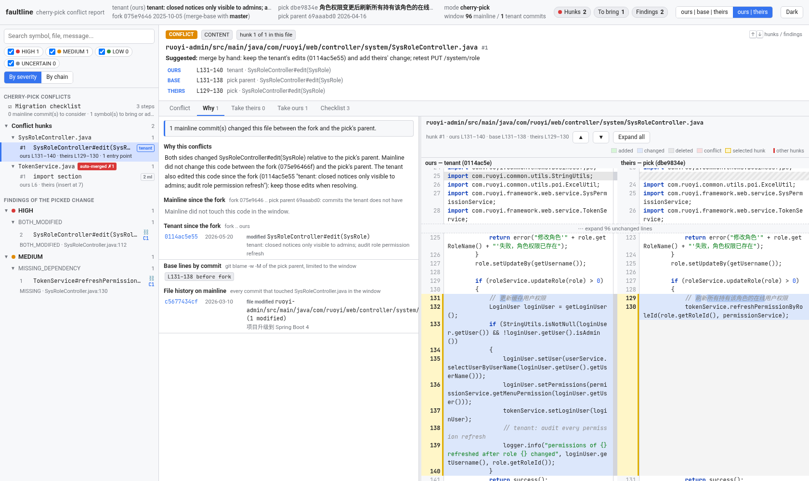
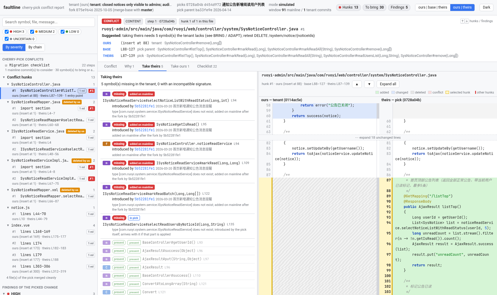
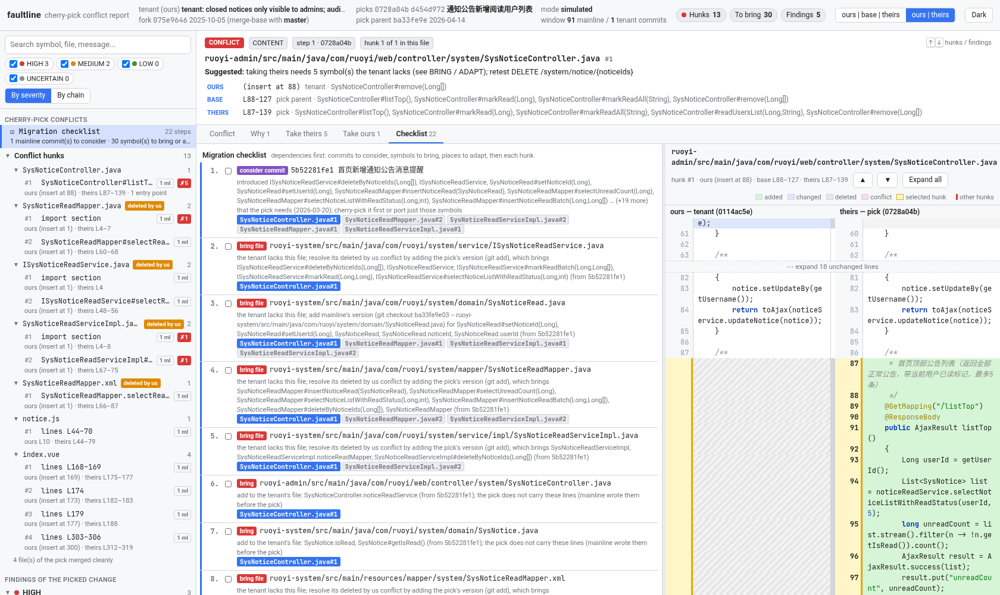
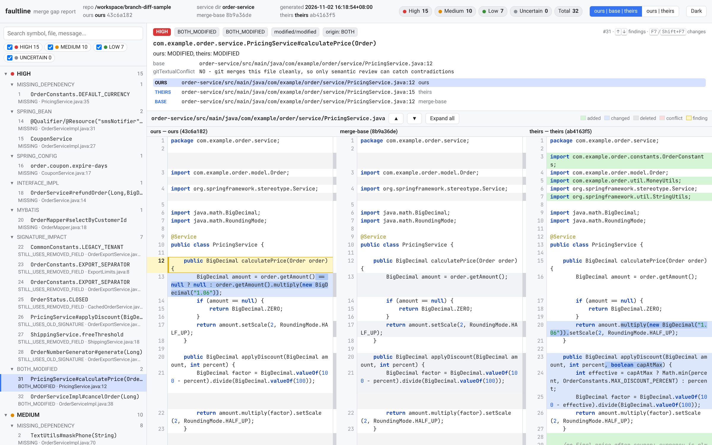
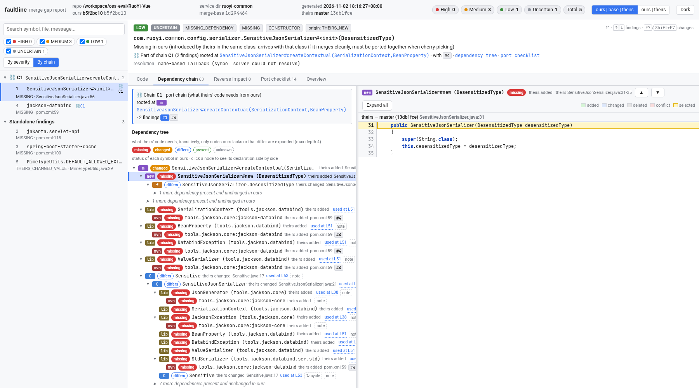

[English](README.md) | 简体中文

# faultline

**租户分支落后主线几个月时，解释 cherry-pick 冲突。**

租户代码很早就从主线分了出去。现在要从主线迁移一个功能（一个或几个提交），cherry-pick 时出现冲突。冲突的代码通常是分叉之后主线新增、重构、改名或删除的代码。`git diff` 只显示冲突的行，看不出相关的调用方和上下文依赖是否都正确。

`faultline conflicts` 对每个冲突块回答五个问题：

| | 问题 | faultline 给出 |
|---|---|---|
| **WHERE 在哪** | 冲突在哪里？ | 文件、行范围以及所在成员（方法、字段、MyBatis 语句、import 区）在 **ours**（租户）、**base**（被 pick 提交的父提交）、**theirs**（被 pick 的提交）三边的位置 |
| **WHY 为什么** | 为什么冲突？ | 从分叉点到 pick 的父提交之间，改过这段代码的主线提交（hash、日期、标题）；成员级历史（新增、修改、改名、移动、签名变化，按方法体识别）；base 行的 `git blame -w -M`；以及租户自分叉以来的修改 |
| **TAKE THEIRS 取主线** | 取 pick 这边需要什么？ | 冲突块 theirs 侧用到的所有符号（方法、字段、类型、Bean、配置项、Mapper 语句、第三方库类型），向下最多 4 层：租户有没有，旧名字是什么，由哪个主线提交引入。也会检查被挪走的 import 和 git 自动合并的行 |
| **TAKE OURS 保留租户** | 保留租户这边会坏什么？ | ours 侧成员在租户里的调用方，一直追到入口：HTTP 方法和路径（`@RequestMapping` 等）、`@PreAuthorize` 权限、`@Scheduled`、`@EventListener` 和 MQ 监听、Runner；还有 pick 里会因此悬空的部分 |
| **CHECKLIST 清单** | 按什么顺序处理？ | 依赖优先：建议先 pick 的主线提交、要带过来的文件、要补进租户文件的符号、需要手工适配的地方（如 `jakarta.*` 与 `javax.*`），然后是逐个解决冲突块，以及需要回归测试的入口 |

pick 中能干净合并的文件也会经过依赖分析：干净合并的代码同样可能用到租户没有的符号。

> 只读。离线模式用 `git merge-tree`，执行的是 cherry-pick 本身的那次合并，不动工作区、index 或任何 ref。实时模式读取 index 的各个 stage 和 `.git/sequencer`。不 checkout，不提交，不推送。

## 构建

需要 JDK 17+、Maven 3.8+、git 2.38+（`git merge-tree --write-tree`）。

```bash
mvn -B package   # 编译 + 单元测试 + 打包
# 产物：target/branch-diff-tool.jar（可执行 fat jar）
```

## 使用

### 实时模式：cherry-pick 进行到一半

```bash
git cherry-pick dbe9834e          # 停在冲突上
java -jar target/branch-diff-tool.jar conflicts --repo . --mainline master --html -o conflicts.html
```

自动识别 `CHERRY_PICK_HEAD` / `MERGE_HEAD` / `REVERT_HEAD`。读取未合并的 index 条目（stage 1/2/3，包括 modify/delete、add/add 冲突），以及 sequencer 中还没应用的提交。不带 `--theirs`、也不带 `--pick` 时，默认子命令就是 `conflicts`。

### 离线模式：pick 之前先看

```bash
# 单个提交
java -jar target/branch-diff-tool.jar conflicts --repo . --onto tenant --pick dbe9834e --mainline master --html -o role.html
# 多个提交：范围，或逗号分隔的列表，按顺序应用
java -jar target/branch-diff-tool.jar conflicts --repo . --onto tenant --pick '0728a04b^..d454d972' --mainline master -o notice.md
```

每个 pick 用 `git merge-tree --write-tree --merge-base=<pick>^ <当前状态> <pick>` 模拟。范围有多步时，后一步合到前一步的结果上。这个结果是用 `git commit-tree` 生成的临时提交，没有任何 ref 指向它，git 之后会自行回收。冲突块按步骤加 `s<N>:` 前缀。

| 选项 | 说明 |
|---|---|
| `--repo <path>` | git 仓库（默认 `.`） |
| `--mainline <ref>` | 主线分支。分叉点为 `merge-base(租户, 主线)`，默认 `merge-base(租户, pick^)` |
| `--onto <ref>` | 离线模式的租户 ref（默认 `HEAD`） |
| `--pick <spec>` | 单个提交、`c1,c2,...` 或范围 `A..B` |
| `--format md\|json\|html`、`--json`、`--html` | Markdown（默认）、JSON，或单个自包含 HTML |
| `-o, --output <file>` | 输出到文件，默认 stdout |
| `--no-maven` | 不运行 `mvn dependency:build-classpath`。速度更快，但第三方库类型只能按启发式判断（见局限） |
| `--fail-on-findings` | pick 需要的符号租户缺失时，退出码为 2（适合 CI） |
| `--include-tests`、`--keep-temp`、`-v` | 同时分析 `src/test/java` / 保留临时源码 / 打印进度 |

### 输出

- **HTML**：单个离线文件，CSS 和 JS 全部内联。
  - 侧栏先列冲突块，按文件分组，并标出 modify/delete。然后是迁移清单，以及 pick 干净部分的发现。
  - 每个冲突块有 **Conflict / Why / Take theirs / Take ours / Checklist** 五个标签页。Conflict 页是类似 IDE 的 ours | base | theirs 视图，当前冲突块描边，其他冲突块加底色。
  - 点击符号、历史事件或调用链节点，可以看到该成员在三边的版本。
  - 打开上下文标签页时，代码区会自动切换为 ours | theirs，顶栏的开关可以切回三栏。
  - URL hash 保存当前状态，如 `#hunk=<id>&ctab=c-why`；`#hunk=__check` 直接打开清单。
- **JSON**：同样的数据放在 `conflicts` 下，同时保留分支分析的字段。
- **Markdown**：先是清单，然后每个文件、每个冲突块一节（where / why / take theirs / take ours），之后是 git 自动合并的行，最后是干净合并的文件。





### 原理

1. **会话**。
   - 实时模式：读取 `ls-files -u -z` 的 stage、`CHERRY_PICK_HEAD` 和 `.git/sequencer/todo`。
   - 离线模式：读取 `merge-tree` 的输出，包括 tree、冲突 stage 和提示信息。
   - 分叉点为 `merge-base(ours, mainline)`。窗口在主线上是 `fork..base`，在租户上是 `fork..ours`。
2. **冲突块**。对每个冲突文件的三个 stage blob 运行 `git merge-file --diff3`，得到三边精确的行范围。只有换行符不同时，先去掉 CR 再算冲突块，并在报告中建议使用 `-X ignore-cr-at-eol`。
3. **成员**。用 JavaParser 解析 Java，并解析 MyBatis XML 语句和 yml/properties 配置项。每个冲突块映射到它覆盖的成员。
4. **历史**。对 base 侧，沿 `git log fork..base` 跟踪文件。对每个提交前后的成员做 diff，先按名字配对，再按方法体相似度（token Dice ≥ 0.75）配对，以识别改名、移动和签名变化。对 base 行运行 `git blame -w -M`。
5. **取主线**。对 theirs 侧成员求依赖闭包，再与租户的索引对照，判断每个符号是存在、缺失、改名还是不兼容。引入它的提交从成员历史中得到。
6. **保留租户**。在租户的反向调用图中，从 ours 侧成员一直追到入口。
7. **清单**。需要的符号按文件分组，依赖排在前面。

## 在 RuoYi-Vue 上的验证

`/workspace/oss-eval/conflict-mode/SCENARIO.md` 记录了在 RuoYi-Vue 克隆上的一次真实运行。租户分支于 2025-10-05 分叉，带有租户自己的修改。从主线 pick 了两个最近的功能：

- 角色权限变更后刷新在线用户权限，它依赖 Spring Boot 4 的 `jakarta` 迁移；
- 通知公告阅读用户列表，它依赖分叉之后新增的整套“已读”子系统。

两种模式（实时和离线）都跑过，其中 3 个冲突块用 `file:line` 和提交逐一手工核对过。

## 局限（冲突模式）

- 离线模式用 `git merge-tree`，而不是临时 worktree。在默认选项下，它的合并结果和 stage 与 `git cherry-pick` 一致；但不会应用自定义 merge driver、`rerere`、`-X` 策略选项和 hook。
- 符号分析只覆盖 Java、MyBatis XML、yml/yaml 和 properties。`.vue`、`.js`、SQL 等文件的冲突块会定位并归因到历史（WHERE、WHY），但不分析内容。
- 使用 `--no-maven` 或 classpath 无法解析时，第三方库类型按启发式判断：租户源码里没有任何文件从该包 import，就算缺失。租户里对应的类型按名字匹配（如 `jakarta.servlet...` 对应 `javax.servlet...`）。这类条目请对照租户的 pom 核实。
- 纯静态分析：反射、AOP、字符串形式的 Bean 名、SpEL 和 XML 装配都不跟踪，仅按名字匹配的调用会标为不确定。依赖链最多 4 层；调用方一直追到入口为止。
- 改名识别要求方法体至少有 6 个 token，过短的成员（getter、单行方法）会显示为删除 + 新增。
- 工具不会替你解决冲突，也不写文件，只负责解释冲突，由你来解决。

---

## 分支模式（次要）

原来的整分支对比仍然可用。它在**方法级**比较 merge-base、ours、theirs，报告 theirs 改了、而 ours 缺失或不一致的代码，包括 git 不报冲突的缺口。

```bash
java -jar target/branch-diff-tool.jar branch --repo . --ours HEAD --theirs origin/feature-x --service-dir order-service --html -o report.html
# （不写子命令、但带 --theirs 时，同样进入分支模式）
```

| 选项 | 说明 |
|---|---|
| `--ours <ref>` / `--theirs <ref>` | 两个分支或提交，merge-base 自动计算 |
| `--service-dir <dir>` | 只分析该子目录 |
| `--include-siblings [deps\|all\|none]`、`--no-siblings` | 把同仓库的兄弟 Maven 模块加入索引（默认 `deps`：服务 pom 依赖的模块） |
| `--mvn <cmd>` / `--maven-timeout <sec>` | Maven 命令和超时 |


### HTML 报告

`--html`（等同 `--format html`）生成**一个自包含的 `.html` 文件**，界面仿 IntelliJ IDEA 的 diff/merge 视图。所有 CSS 和 JavaScript 都内联：不依赖 CDN、不访问网络，可离线打开，也可以直接附到工单或邮件里。

```bash
java -jar target/branch-diff-tool.jar --repo . --theirs feature-x --service-dir order-service --html -o report.html
```



- **侧边栏**：按严重级别（HIGH / MEDIUM / LOW / UNCERTAIN）再按类别分组的问题树，带计数、按组过滤开关和搜索框（符号、文件、消息、状态）。
- **顶栏**：仓库、服务目录、ours / merge-base / theirs 的引用与提交，以及各级别数量。
- **问题卡片**：严重级别、状态、种类、符号、来源、说明、详情，以及所有位置（`needed by` / `used at` / ours / theirs / base），点击即跳转，必要时自动切换文件。
- **差异视图**：三栏 `ours | merge-base | theirs`（可切换为两栏 `ours | theirs`），带行号；所有栏位在同一个滚动容器中，同步滚动；新增（绿）、修改（蓝）、删除（灰）、冲突（红，双方改了同一段 base 行）分块着色，并有词级行内高亮；未改动区域折叠为“expand N lines”行（也可 *Expand all*）。当前问题所在行会高亮并自动滚动到视野中央。
- **语法高亮**：Java、XML（标出 MyBatis 的 `#{}` / `${}`）、YAML、properties（内置的小型分词器）。
- **键盘**：<kbd>↑</kbd>/<kbd>↓</kbd> 或 <kbd>j</kbd>/<kbd>k</kbd> 切换问题，<kbd>F7</kbd> / <kbd>Shift+F7</kbd> 跳到下一处 / 上一处改动。
- **主题**：IDEA Light（默认）和类 Darcula 的深色主题。
- **URL hash** 保存状态，例如 `report.html#finding=3&mode=2col&theme=dark`（`target=N` 选中该问题的第 N 个位置；`tab=deps|impact|check|overview`、`node=<key>`、`group=chain`、`ov=all` 打开上下文视图），方便分享链接和无头浏览器截图。

只嵌入问题涉及的文件，内容直接从 git 的三个版本读取；超过 1 MB 的版本不嵌入并给出说明。行级 diff（Myers 算法，[java-diff-utils](https://github.com/java-diff-utils/java-diff-utils)，Apache-2.0）在 Java 端计算后以 JSON 嵌入；三栏视图按 merge-base 区间把 ours 与 theirs 的改动分组，做法与 `diff3` 相同。`docs/sample-report.html` 是下文验证样例的报告。

#### 上下文与依赖链

每个问题还带有代码上下文，由同一套三方索引计算（JSON 报告中的 `context` 字段，Markdown 第 7 节）：

- **Dependency chain** 页签：从 theirs 中需要该符号的代码（例如 Controller 方法）到缺失或变化的符号，再到该符号*自身*的依赖，逐层展开（方法、构造器、字段与常量、类、Spring Bean、配置项、MyBatis 语句、第三方库类型及提供它的 Maven 构件）。每个节点显示种类、`文件:行号` 和在 ours 中的状态：`missing`（缺失）、`changed`（签名或类型不兼容）、`differs`（存在但 theirs 改过）、`present`、`unknown`，以及由哪一方修改。只展开 ours 缺失或有差异的节点（最多 4 层，环会标出并截断）；存在且未变的依赖折叠为“N more”。
- **Reverse impact** 页签：对被删除、改名、改类型或改值的符号（SIGNATURE_IMPACT、CONSTANT_VALUE、BOTH_MODIFIED 等），列出 ours 中使用它们的代码，最多 3 层调用方，带 “uses it at L..” 链接。
- **Port checklist** 页签：属于同一条链的问题会归为一组（`⛓ C1`，侧边栏 *By chain*），并给出一份按依赖优先排序的移植清单，每一步附动作（“Add constructor”、“Add the dependency to ours' pom.xml”、“Update this method in ours” 等）。勾选状态不保存。
- **Overview** 页签：内联 SVG，展示该链（或全部链）涉及的文件，从需要方指向提供方，按最严重状态着色。
- 点击任意节点，右侧并排显示它所在的完整成员（ours / merge-base / theirs），沿用原有的 diff 高亮；不包含该成员的版本不显示（变为一栏或两栏）。面板与代码之间的分隔条可拖动。




### 检测内容

1. **方法级变更集**（base→theirs、base→ours）：按 `类全限定名#方法名(参数类型...)` 识别 ADDED / REMOVED / MODIFIED / SIGNATURE_CHANGED（同名不同参）/ RENAMED（方法体相同、名字不同）。比较时去掉注释和格式，因此只改注释、格式或位置不算修改。
2. **依赖闭包**：对 theirs 新增/修改的每个方法，收集其调用的方法、构造器、引用的类型、字段、常量（含枚举常量、方法引用、注解），逐一检查 ours 中是否存在且签名兼容：
   - `MISSING`（不存在）/ `INCONSISTENT`（存在但参数、返回类型、static 等不一致）；
   - 来源 `origin`：`THEIRS_NEW`（theirs 新引入，需要一起迁移）、`OURS_REMOVED` / `OURS_CHANGED`（merge-base 中有、ours 删除或修改了——**git 不会报任何冲突**，最危险）；
   - 整个类在 ours 中缺失时合并成一条 TYPE 记录。
   - 使用 JavaParser SymbolSolver（项目源码 + JDK + `mvn dependency:build-classpath` 得到的 jar）；解析失败时退化为按名称/参数个数匹配，并标记为 **UNCERTAIN**，不会中断。
3. **Spring 专项**
   - 注入点：`@Autowired` / `@Inject` / `@Resource` 字段、构造器注入（含 Lombok `@RequiredArgsConstructor` / `@AllArgsConstructor`）、`@Autowired` setter、`@Bean` 方法参数、`@Qualifier` / `@Resource(name=)` 名称。检查 ours 中是否有对应 bean（`@Component/@Service/...`、`@Bean`、MyBatis Mapper、Spring Data Repository、`@FeignClient`）。
   - 配置键：`@Value("${...}")`（有默认值的不报）、`Environment.getProperty("...")`、`@ConfigurationProperties(prefix)` 的字段，对照 ours 的**所有** `application*.yml|yaml|properties`、`bootstrap*`（所有 profile，含多文档 yml；支持宽松绑定 `max-items` ≈ `maxItems`）。
   - 接口/抽象方法：theirs 在接口（非 default）或抽象类中新增的抽象方法，ours 的哪些实现类没有实现；区分"ours 独有的实现类"（HIGH，合并后必然编译失败）和"theirs 版本已实现、随合并带来"（LOW）。
   - MyBatis：Mapper 接口方法（无 `@Select` 等注解时）与 XML `namespace` + `<select|insert|update|delete id>` 的对应；theirs 新增的 XML id 在 ours 中缺少接口方法或语句。
   - Maven：theirs 的 pom 中新增、ours 没有的依赖。
4. **签名变更反向影响**：theirs 删除、重命名、改参数或改返回类型的方法（以及删除的类型），找出 ours 中仍按旧形式调用的位置（file:line）。调用方是 ours 新增/修改的代码 → HIGH（合并不会帮你改）；调用方未变且 theirs 已更新 → LOW；调用方在 ours 未变、在 theirs 已删除或改名 → LOW（整分支合并会一并删除；cherry-pick 时需复查）；其他 → MEDIUM。
   - **字段/常量反向追踪**（`STILL_USES_REMOVED_FIELD`）：theirs 删除或改名的字段（实例字段、`static final` 常量、接口常量、枚举常量；所在类在 theirs 中仍存在、ours 仍保留该字段），扫描 ours 中仍引用它的位置：方法/构造器体、字段初始化表达式、枚举常量参数、初始化块，支持 `Type.NAME`、`this.x`、无限定名、`import static`。优先用 SymbolSolver 确认引用的就是该声明（同名局部变量、其他类的同名常量不会误报）；解析失败时退化为按 import/作用域匹配并标记 UNCERTAIN。
   - 改名识别：theirs 在同一类中新增的字段类型、static/枚举属性相同且**初始化表达式相同（非空）**且唯一 → `*_RENAMED`（报告给出新名字），否则为 `*_REMOVED`。
   - 严重度规则与方法相同：引用所在的方法/声明是 ours 新增或修改的（或整个类只有 ours 有）→ HIGH；ours 未改动、theirs 版本已不再引用或已删除 → LOW；其他 → MEDIUM。同一成员内的多处引用合并为一条（`moreReferences`）。
   - 反方向（ours 删除了字段/常量，而 theirs 新增/修改的代码仍需要它）由第 2 项依赖闭包报告为 `MISSING … OURS_REMOVED`（样例 G1c），因此两个方向都覆盖。
5. **兄弟模块**（`--include-siblings`，默认 `deps`）：
   - 发现：读取每个版本（base/ours/theirs）的全部 `pom.xml`，从服务 pom 的 `<dependency>` 出发（忽略 `test` scope），按 `groupId:artifactId` 匹配仓库内的模块（groupId 写成 `${project.groupId}` 等属性时按唯一 artifactId 匹配），并沿兄弟模块自己的依赖传递；三个版本的结果取并集，再从每个版本加载这些模块的 `src/main/java`。
   - 兄弟模块的类进入类型解析和符号索引（查找时可见），但**不进入报告范围**：兄弟模块自身的方法变更不会成为"theirs 新增/修改的方法"去做依赖分析，不会进入双方修改列表、附录变更集、注入点/配置键/MyBatis 检查；只有 `--service-dir` 中的代码会作为调用方/需要方被报告。另一方面，兄弟模块的 API 变化会影响服务：theirs 删除/改名兄弟模块中的方法、类型、字段，ours 服务代码仍在使用 → 第 4 项报告；theirs 在兄弟模块接口中新增抽象方法、ours 服务中的实现类未实现 → 第 3 项报告。
   - 兄弟模块中的 `@Component`/`@Bean` 等也计入 ours 已有的 bean。若服务和兄弟模块存在同 FQN 的类，以服务中的为准（给出 warning）。
   - Maven classpath：兄弟模块一般没有安装到本地仓库，`dependency:build-classpath` 会因此整体失败，所以在**临时副本**的服务 pom 中删除对兄弟模块的 `<dependency>`（它们的源码已经交给 SymbolSolver）。
   - 默认开启 `deps` 的理由：只加载服务**声明依赖**的模块，代价是多读几个 pom 和这些模块的源码（样例中 4–5 个文件，耗时可忽略）；不会把无关服务的代码混进来（避免同名类冲突、减少名称匹配噪声）；兄弟模块的代码永远不会单独产生报告，所以开启后已有的结果只会多出真实的跨模块缺口（样例中 `--no-siblings` 与默认相比只少了 G10 的两条）。`all` 适合非 Maven 声明的依赖关系，但在大型 monorepo 中更慢、噪声更多，因此不作为默认。
6. **双方都修改的方法**：单独列出供人工审查，附 base→ours、base→theirs 的方法级 diff，并用 `git merge-file`（在临时文件上）预测该文件**是否会产生文本冲突**——"NO" 意味着 git 会静默合并，只能靠人工审查发现逻辑矛盾。双方做了相同修改的方法不报。
7. **值变更**（三方比较，仅服务目录；报告第 4b 节）：没有方法级变更集的改动。
   - 字段 / 常量初始化表达式（`static final` 常量、数组/集合初始化、实例字段初始化）以及枚举常量参数，去掉注释和格式后比较。类别 `CONSTANT_VALUE`，kind 为 `CONSTANT` / `FIELD` / `ENUM_CONSTANT`。
   - MyBatis mapper XML 元素内容，按 `namespace` + 标签 + `id` 匹配 `<select|insert|update|delete|sql|resultMap>`，去掉 XML 注释、属性排序、压缩空白后比较。类别 `MYBATIS`，kind 为 `MAPPER_<标签>`，给出语句 id 和 `file:line`。
   - 模型与方法一致：

     | base / ours / theirs | 状态 | 严重度 | 说明 |
     |---|---|---|---|
     | base = ours ≠ theirs | `THEIRS_CHANGED_VALUE` / `THEIRS_CHANGED_STATEMENT` | LOW | 整分支合并会自动带上 theirs 的值；向单独维护的分支回移/cherry-pick 时必须一并移植（与同类 `THEIRS_NEW` 依赖的约定相同）。只有 theirs 修改的方法体在附录变更集中可见，值没有附录，所以在这里报告 |
     | base ≠ ours、base ≠ theirs、ours ≠ theirs（或 base 中不存在、双方各自添加了不同的值） | `BOTH_CHANGED_*` / `BOTH_ADDED_*` | HIGH | 冲突修改，同"双方都修改的方法"；附 `git merge-file` 文本冲突预测 |
     | 未改、仅 ours 修改、双方相同修改、仅注释/格式变化、ours 已删除 | — | 不报 | |

报告章节：概览统计 → 缺失依赖 → Spring 配置/Bean 缺口 → 签名变更影响（含已删除/改名字段）→ 4b 值变更（常量、MyBatis 语句内容）→ 双方修改 → 不确定项 → 附录（完整方法变更集，仅服务目录）。JSON 与 Markdown 内容一致。

### 验证样例

`scripts/create-sample.sh [目标目录]` 生成样例仓库（默认 `/workspace/branch-diff-sample`），含 merge-base、`ours`、`theirs` 三个提交，服务目录 `order-service`，并埋入以下问题：

| 编号 | 埋入的问题 | 期望 |
|---|---|---|
| G1 | theirs 新增 `PricingService.calculateFinalPrice`，调用仅 theirs 有的 `MoneyUtils.roundHalfUp`、新常量 `MAX_DISCOUNT_PERCENT`，以及被 ours 删除的 `DEFAULT_CURRENCY` | 报告（后者为 OURS_REMOVED / HIGH） |
| G2 | 新 `@Autowired CouponService`（仅 theirs 有）、`@Qualifier("smsNotifier")` | 报告 |
| G3 | `@Value("${order.coupon.expire-days}")`、`@ConfigurationProperties("order.payment")`，键只在 theirs 的 yml | 报告 |
| G4 | 接口新增 `refundOrder`，ours 独有的 `CachedOrderService` 未实现 | 报告（HIGH） |
| G5 | Mapper 新方法 `selectByCustomerId` + XML id | 报告 |
| G6 | `generate` 重命名为 `nextOrderNo`、`applyDiscount` 加参数，ours 新代码仍用旧形式 | 报告（HIGH） |
| G7 | `cancelOrder`（有文本冲突）、`calculatePrice`（git 可干净合并但双方都加了税 → 重复计税） | 列入双方修改 |
| G8 | theirs 新增 lombok 依赖 | 报告 |
| G9a | theirs 把常量 `OrderConstants.EXPORT_SEPARATOR` 改名为 `CSV_SEPARATOR`；ours 新代码 `OrderExportService#exportLine` 和 ours 独有类 `ExportLimits.SEP` 的字段初始化仍用旧名 | 报告（CONSTANT_RENAMED / HIGH，两处） |
| G9b | theirs 删除枚举常量 `OrderStatus.CLOSED`，ours 独有的 `CachedOrderService#isClosed` 仍在用 | 报告（ENUM_CONSTANT_REMOVED / HIGH） |
| G9c | theirs 把实例字段 `ShippingService.freeThreshold` 改名为 `freeShippingThreshold` 并更新 `fee()`；ours 新增的 `isFreeShipping()` 仍用旧名（git 能干净合并该文件，合并后编译失败） | 报告（FIELD_RENAMED：`isFreeShipping` HIGH，`fee` LOW） |
| G10a | 兄弟模块 `common`（服务 pom 依赖 `order-common`）：theirs 在 `TextUtils` 新增 `maskPhone`，theirs 服务代码 `refundOrder` 调用它，ours 的 `common` 没有 | 报告（MISSING METHOD / THEIRS_NEW，theirs 位置指向 `common/...`） |
| G10b | theirs 删除兄弟模块常量 `CommonConstants.LEGACY_TENANT`，ours 新代码 `OrderExportService` 仍在用 | 报告（CONSTANT_REMOVED / HIGH） |
| N1–N12 | 仅注释改动、调用已存在的方法、带默认值的 `@Value`、只在 profile 文件中的键、注入已存在的 bean、ours 自己的改动、库调用、双方相同修改、其他服务目录、带 `@Select` 的 Mapper 方法、default 接口方法、有 Java 默认值的配置字段 | **不**报告 |
| N13 | theirs 删除 ours 中无人使用的常量 `LEGACY_CHANNEL` | **不**报告 |
| N14 | theirs 删除 `OrderConstants.MAX_ITEMS`，ours 只通过 `import static` 使用自己的 `ExportLimits.MAX_ITEMS`（同名不同声明） | **不**报告 |
| N15 | theirs 服务代码调用兄弟模块中两边完全相同的 `IdUtils.isValid`、已存在的 `TextUtils.trimToEmpty` | **不**报告 |
| N16 | 兄弟模块内部的变化：theirs 新增仅被 `common` 自己使用的 `maskEmail`/`MaskingSupport`；`DateUtils.today()` 被双方不同地修改 | **不**报告（不在 `--service-dir` 范围） |

```bash
scripts/create-sample.sh
java -jar target/branch-diff-tool.jar --repo /workspace/branch-diff-sample \
  --ours ours --theirs theirs --service-dir order-service -o docs/sample-report.md
```

`SampleRepoEndToEndTest` 在 `mvn package` 时自动执行上述流程（离线、`--no-maven` 模式），断言每个 G 项都被报告、每个 N 项都没有被报告；并分别以 `--include-siblings none` / `all` 再跑一次：`none` 时 G10 两条消失、其余不变，`all` 时额外索引 `other-service` 但结果与默认相同（N10 仍不报告）。生成的报告见 `docs/sample-report.md` / `docs/sample-report.json`。

### 已知局限（分支模式）

- **反射**：`Class.forName`、`Method.invoke`、字符串形式的类名/方法名无法追踪。
- **动态代理 / AOP / 运行时生成代码**：JDK/CGLIB 代理、Feign、Spring Data 派生查询方法（`findByXxx`）、MyBatis-Plus `BaseMapper` 的继承方法、Lombok 生成的 getter/setter 等不在源码中，只能按"外部"处理；对它们的缺失无法确认。
- **字符串形式的 bean 名称**：`getBean("xxx")`、XML 配置的 bean、`@Import` / 自动配置 / `spring.factories` 提供的 bean，以及 `@Conditional*` 条件是否满足，都不在分析范围；`@Qualifier` 找不到时标为 UNCERTAIN。
- **双方都修改的方法中的逻辑矛盾**：工具只能列出并给出 diff 和是否有文本冲突，**无法判断语义是否矛盾**（例如样例中两边都加税），必须人工审查。
- 配置：只读服务目录内 `application*/bootstrap*` 文件；环境变量、配置中心（Nacos/Apollo）、命令行参数、`@PropertySource` 指定的其他文件不在范围（此类键标为 UNCERTAIN）。
- 多模块：
  - `deps` 模式只认 Maven pom 中声明的依赖；Gradle、`build-helper` 额外源码目录、非 `src/main/java` 布局不识别（可用 `all`，但 `all` 也只认 `<dir>/src/main/java`）。版本号/`<classifier>` 不参与匹配。
  - 兄弟模块的 `application*.yml`、MyBatis XML 不读取（配置键只对照服务目录）；兄弟模块中的 bean 一律算作"存在"，不判断是否被组件扫描/自动配置覆盖。
  - 临时 pom 去掉兄弟模块依赖后，兄弟模块**自己**声明的第三方依赖不会进入 classpath，兄弟模块代码中引用的库类型可能解析失败（只影响对兄弟模块内部的解析，必要时退化为名称匹配）。
  - 兄弟模块中与服务无关的变化（兄弟模块内部缺口、兄弟模块中双方都修改的方法）按设计不报告；兄弟模块之外仍未被选中的模块依旧视为外部库。Maven 多模块的 classpath 解析若失败会降级为名称匹配。
- 方法级匹配基于简单类型名（擦除泛型），同名不同包的参数类型可能误判为相同；类整体改包/改名会表现为"删除 + 新增"。
- 字段反向追踪：只处理"删除/改名"，不报告字段**类型变化**或 static/final 变化；改名识别依赖相同的非空初始化表达式，无初始化表达式的字段和无参枚举常量改名会报告为 `*_REMOVED`（不给出新名字）；字段移动到其他（非父类）类视为删除。方法内**局部类**（local class）中的引用、字符串形式的引用（反射、SpEL、MyBatis XML 中的 `#{field}`）不扫描。
- 值变更：只比较初始化表达式 / XML 文本本身。初始化表达式未变、但引用了另一个已变常量的常量不单独报告（被引用的那个会报）；在 static 块或构造器中赋值、运行时计算的值，以及兄弟模块或服务目录之外的 XML 不在范围内。兄弟模块中仅 theirs 修改的值不报告（需把该模块作为 `--service-dir` 运行）。`<include>` 引用的片段按其自身的 `<sql>` 元素比较，不做内联展开。
- HTML 报告：diff 基于整个文件的文本行（不是 AST），方法移动位置会显示为删除 + 新增；行内高亮是词级的，并把块内第 k 个改动行与另一侧第 k 行配对；三栏分组是 `diff3` 式的近似，个别边界情况可能与 `git merge-file` 不同（权威的文本冲突预测仍以卡片详情为准）。只嵌入问题涉及的文件；超大报告不分页。
- 依赖链：沿用分析器的静态解析，名称匹配的调用标为不确定，反射、AOP、XML/字符串装配不跟踪；依赖树最多 4 层（反向影响最多 3 层调用方），每个节点最多 40 个子节点；反向影响只覆盖范围内的 ours 代码。第三方库类型只在两侧 Maven classpath 都解析成功时检测（`--no-maven` 下没有），且只有本地仓库布局下的 jar 才能映射到构件；ours 也能解析到的库类型（例如来自别的构件）不会报告。缺少 classpath 时，无法解析的继承调用（例如继承 commons-lang3 `StringUtils` 的工具类）可能产生误报，并被合并成一条大链。问题之间通过共同的调用方，或 ours 缺失/不兼容的依赖关联；仅内容不同的共享依赖不会把它们连成一条链。成员视图最多 1500 个成员，每个最多 400 行。
- 未实现"对合并结果执行 `mvn compile`"的可选检查（需求中注明非必须）。
